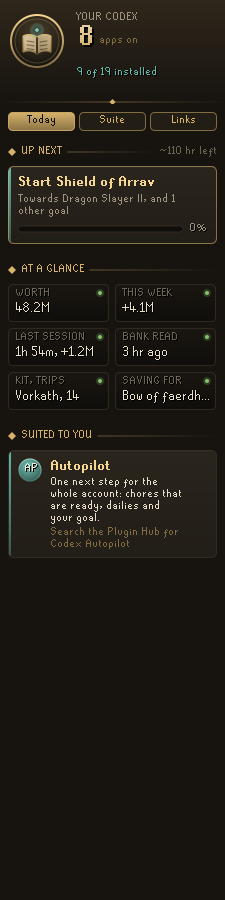
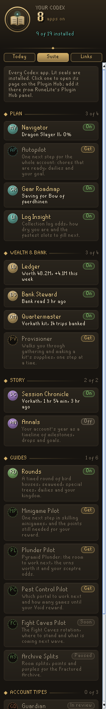
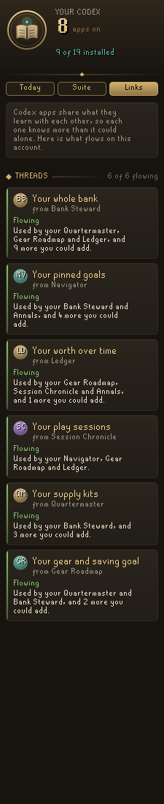

# Codex Home

The front door of the **Codex** suite of RuneLite plugins. One panel shows what every Codex app knows about your account, which apps you have and what each is doing, and which one to add next.

  

## Today
- **Up next**: the next step towards the goal you pinned in Codex Navigator, how far along it is and the hours Navigator thinks are left.
- **At a glance**: your worth and how it moved this week (Codex Ledger), your last session and what it earned (Codex Session Chronicle), when your bank was last read (Codex Bank Steward), your supply kit and how many trips the bank covers (Codex Quartermaster), and what you are saving for (Codex Gear Roadmap).
- **Start here**: five first steps that get the suite sharing with itself. They tick themselves as you do them, and each one says which of your apps it helps.
- **Suited to you**: up to three apps worth adding. Ultimate Ironmen are pointed to Codex Nomad and ironmen to Codex Ironworks, and an app that would feed several you already have comes before the rest.

## Suite
Every Codex app by family (Plan, Wealth & bank, Story, Guides, Account types). Installed apps have a lit seal, an On or Off mark and a live line taken from what they share, such as "Bank read 3 hr ago" or "Vorkath kit, 14 trips banked". Click an app to open its Plugin Hub page.

## Links
Codex apps share what they learn with each other. Links shows each thread (your bank, goals, worth, sessions, supply kits and gear), whether it is flowing on this account, and which of your apps use it.

## A login line
At login Home can put one line in the chat box, such as `Codex: next, Start Shield of Arrav (Dragon Slayer II). Worth 48.2M (+4.1M this week).` Turn it off in the settings.

## What it does not do
Home only reads. It reads the data the other Codex apps already save for each other in your RuneLite profile, and RuneLite's own list of installed plugins. It never changes another plugin's settings, never switches plugins on or off, never clicks or changes menus, and sends nothing off your computer. The only thing it saves is the tab you last had open.

## Field notes

An optional setting, **Keep field notes** (under Field notes, off by default), writes a plain record of what Codex Home reads and decides to its own folder in `.runelite/plugin-data` on your computer, one line at a time. It is for checking the plugin's guesses against real play: when something looks wrong, the notes show what it saw and why it chose what it did. Other players' chat is never written down, it stays on your computer, and nothing is sent anywhere.

## Licence
BSD 2-Clause.
