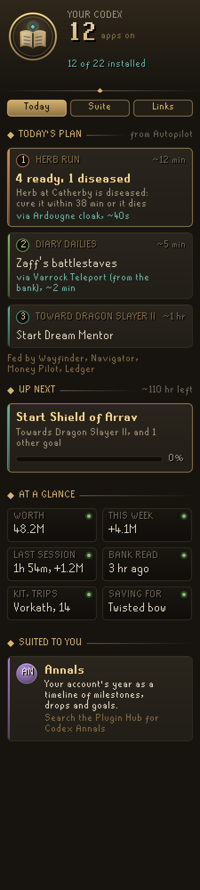
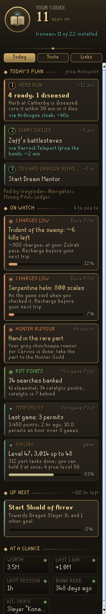

# Codex Home

The front door of the **Codex** suite of RuneLite plugins. One panel shows what every Codex app knows about your account, which apps you have and what each is doing, and which one to add next.

  

 

## Today
- **Today's plan**: Codex Autopilot's next three steps for the whole account, in its order (going to waste, ready chores, your focus, other goals), each with how long it takes and, when Codex Wayfinder is on, the way there ("via Ardougne cloak, ~40s"). The first shows why it is first, and a line says which Codex apps fed the plan. Read from the plan Autopilot shares (`codexautopilot/planV1`); a plan more than half an hour old says when it was saved.
- **On watch**: the few things across the suite worth a glance before you set off, what needs doing first. A charged item running low (Codex Boss Pilot's charge counts: fewer than 10 kills left at your own pace there, or under a tenth full when no pace is learnt yet), your Hunter Guild rumour and a rare part waiting to be handed in (Codex Autopilot), the Guardians of the Rift searches you have banked and your last Tempoross game with your permits an hour (Codex Minigame Pilot), and your Sailing: level, experience to the next, port tasks done and how many you can hold at once. Each row says which app it came from; Sailing is read from the game. Further ready steps in Autopilot's plan are counted under it ("+ 2 more ready in Autopilot").
- **Up next**: the next step towards the goal you pinned in Codex Navigator, how far along it is and the hours Navigator thinks are left.
- **At a glance**: your worth and how it moved this week (Codex Ledger), your last session and what it earned (Codex Session Chronicle), when your bank was last read (Codex Bank Steward), your supply kit and how many trips the bank covers (Codex Quartermaster), and what you are saving for (Codex Gear Roadmap).
- **Start here**: five first steps that get the suite sharing with itself. They tick themselves as you do them, and each one says which of your apps it helps.
- **Suited to you**: up to three apps worth adding. Ultimate Ironmen are pointed to Codex Nomad and ironmen to Codex Ironworks, and an app that would feed several you already have comes before the rest.

## Suite
Every Codex app by family (Plan, Wealth & bank, Story, Guides, Account types), Codex Wayfinder, Money Pilot and Boss Pilot among them (marked Soon until they are on the Plugin Hub). Installed apps have a lit seal, an On or Off mark and a live line taken from what they share, such as "Bank read 3 hr ago" or "Vorkath kit, 14 trips banked". Click an app to open its Plugin Hub page.

## Links
Codex apps share what they learn with each other. Links shows each thread (your bank, goals, worth, sessions, supply kits, gear, and the travel atlas, money makers' rates and pinned boss that Codex Autopilot plans with), whether it is flowing on this account, and which of your apps use it. Wayfinder's travel atlas also feeds Codex Nomad, Ironworks and Provisioner, which draw its routes.

## A login line
At login Home can put one line in the chat box, such as `Codex: next, Start Shield of Arrav (Dragon Slayer II). Worth 48.2M (+4.1M this week).` When something needs doing before your next trip (a charged item running low, a rumour part to hand in) the line ends with it. Turn either off in the settings.

## What it does not do
Home only reads. It reads the data the other Codex apps already save for each other in your RuneLite profile, and RuneLite's own list of installed plugins. It never changes another plugin's settings, never switches plugins on or off, never clicks or changes menus, and sends nothing off your computer. The only thing it saves is the tab you last had open.

## Licence
BSD 2-Clause.
